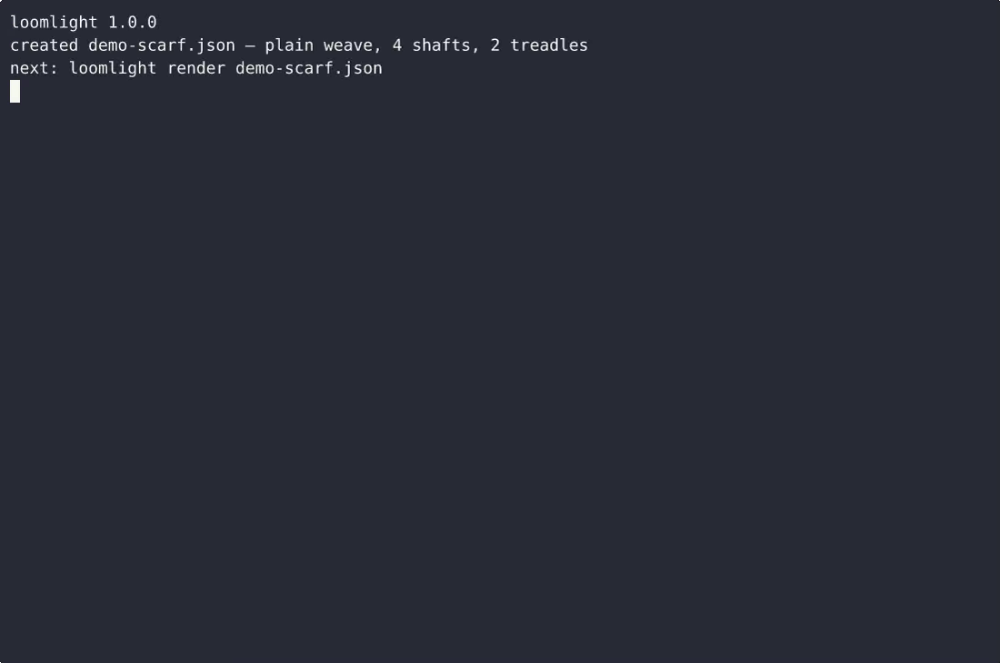
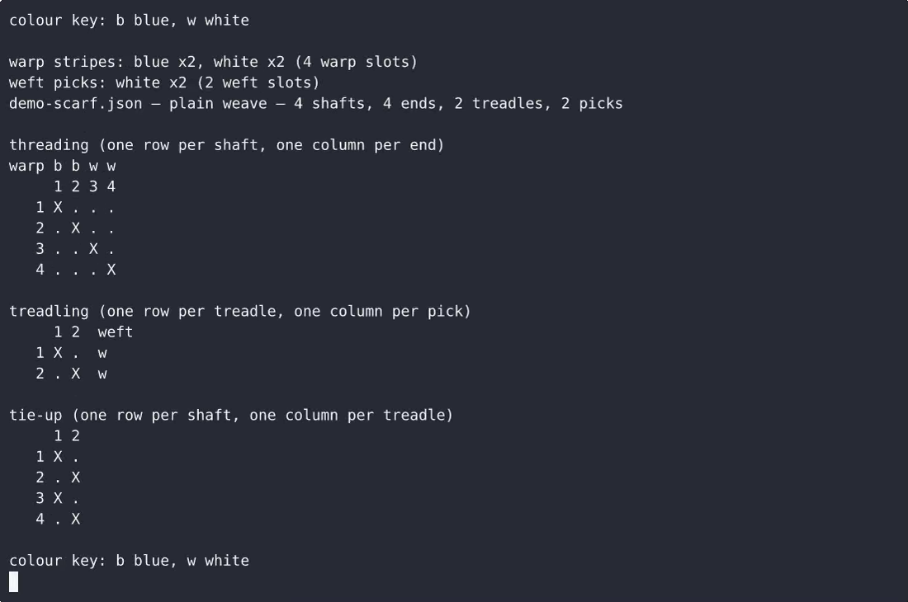

# Loomlight — complete Full-stack app command-line tool example app

Clone it. Run it. Own it. **Loomlight** is a complete, Apache-2.0-licensed command-line tool in Full-stack app — full source, demo data included. Loomlight is a single-file, standard-library-only Python command-line tool that does three jobs for a hand-weaver: it seeds a weaving draft (shafts, treadles, plain or twill), lets you draw that draft cell by cell in…. Self-host Loomlight on your own infrastructure, or open it on [cenius.ai](https://cenius.ai/marketplace/p/loomlight?ref=gh&utm_campaign=loomlight-webapp) to request changes and get a Loomlight fresh build.


[](LICENSE)  [](https://cenius.ai)

[](https://cenius.ai/marketplace/p/loomlight?ref=gh&utm_campaign=loomlight-webapp)

> **▶ [Open & edit in cenius.ai](https://cenius.ai/marketplace/p/loomlight?ref=gh&utm_campaign=loomlight-webapp)** — one click to an editable workspace: describe changes in plain English, get an instant preview, one-click deploy and host. Modifications made on the platform come with full rebrand & relicense rights.

_Local clone? See [Quick start](#quick-start) below. cenius.ai is the zero-setup path._

## Demo


▶ **[Full demo walkthrough](https://cenius.ai/marketplace/p/loomlight?ref=gh&utm_campaign=loomlight-webapp)** — watch it on the project page · [download MP4](.github/media/demo.mp4)

## Screenshots

 

## Quick start

```bash
./install.sh   # installs dependencies + seeds demo data
```

See [`INSTALL.md`](INSTALL.md) for full setup and usage instructions.

## Features

- Interactive cell-by-cell draft designer
- Draft seeding from parameters (plain / twill)
- Warp and weft color planner
- Yardage estimator
- Project save and load (JSON .loom)

## Architecture

`install.sh` wires up dependencies and loads seed records; after it runs the app has real data to show. The Full-stack app codebase (24 files) is self-contained — no external services needed to evaluate it. Top-level layout: `examples/`, `tests/`. Installation walkthrough: [`INSTALL.md`](INSTALL.md).

## Usage guide

Everything below runs offline and non-interactively except `loomlight edit`,
which needs a terminal.

### 1. Draft a plain-weave scarf

```sh
python3 loomlight.py new --out scarf.json --shafts 4 --treadles 2 --structure plain
python3 loomlight.py render scarf.json
```

`new` writes a straight-draw threading (`1 2 3 4`), a treadling of `1 2`, a
tie-up where treadle 1 lifts the odd shafts and treadle 2 the even ones, a
zeroed `dimensions` block and a one-stripe warp and one-pick weft plan. The file
validates and renders the moment it is written.

```
scarf.json — plain weave — 4 shafts, 4 ends, 2 treadles, 2 picks

threading (one row per shaft, one column per end)
  1 2 3 4
1 X . . .
2 . X . .
3 . . X .
4 . . . X
```

Useful details:

* `--out` defaults to `draft.json` and refuses to overwrite an existing file:
  it exits 2 and leaves the file byte-identical unless you pass `--force`.
* `--shafts` and `--treadles` accept 2..32. Plain weave needs an even shaft
  count (it writes the 1/3 and 2/4 tie-up) and uses exactly 2 treadles; twill
  needs shafts equal to treadles and writes the diagonal tie-up.
* A rejected seed writes nothing at all.

```sh
python3 loomlight.py new --out triangle.json --shafts 5 --structure plain
## plain weave needs an even shaft count        (exit 2, no file written)

python3 loomlight.py new --out twill8.json --shafts 8 --treadles 8 --structure twill
python3 loomlight.py new --out broken.json --shafts 8 --treadles 4 --structure twill
## twill weave needs shafts and treadles to match, got 8 shafts and 4 treadles
```

_Full guide: [`USAGE.md`](USAGE.md)_

## FAQ

### How do I get Loomlight running locally?

Pull the repo, run `./install.sh`, and you are up — the script installs packages and pre-seeds the database. [`INSTALL.md`](INSTALL.md) covers any platform-specific tweaks.

### Can I rebrand or white-label Loomlight?

Yes. You can edit the source directly under the MIT license, or [remix it on cenius.ai](https://cenius.ai/marketplace/p/loomlight?ref=gh&utm_campaign=loomlight-webapp) — the platform route grants full rebrand and relicense rights over your derivative.

### Which framework or language does Loomlight use?

Full-stack app. The full source in this repository is exactly what the app runs. Highlights include interactive cell-by-cell draft designer.

### What if I want to add features to Loomlight without coding?

Non-developers can use [cenius.ai](https://cenius.ai/marketplace/p/loomlight?ref=gh&utm_campaign=loomlight-webapp) to make changes. Describe your goal in everyday language and the platform delivers an updated, ready-to-run project — zero coding on your part.

### Is it OK to ship Loomlight as part of a product?

It is. Apache-2.0 licensing means you can build a product on it, sell it, or use it inside a company with no fees. Details: [LICENSE](LICENSE).

## License & rebranding

Released under the [Apache License 2.0](LICENSE) (© 2026 Cenius AI) — free for personal and commercial use. The Cenius name/logo are trademarks (see NOTICE).

**Need a customized version?** [Remix this app on cenius.ai](https://cenius.ai/marketplace/p/loomlight?ref=gh&utm_campaign=loomlight-webapp) — modifications made on the platform come with **full rebrand & relicense rights** over your derivative.

## Built with cenius.ai

This entire application — code, design, seeded demo data — was generated on **[cenius.ai](https://cenius.ai)** from a plain-English description.

- 🚀 [Build your own app on cenius.ai](https://cenius.ai)
- 🎛️ [Remix Loomlight on the marketplace](https://cenius.ai/marketplace/p/loomlight?ref=gh&utm_campaign=loomlight-webapp) — open it in a workspace, prompt for changes, and ship your own version.

More open-source apps: [the Cenius-ai catalog](https://github.com/Cenius-ai) · [showcase index](https://github.com/Cenius-ai/showcase)
